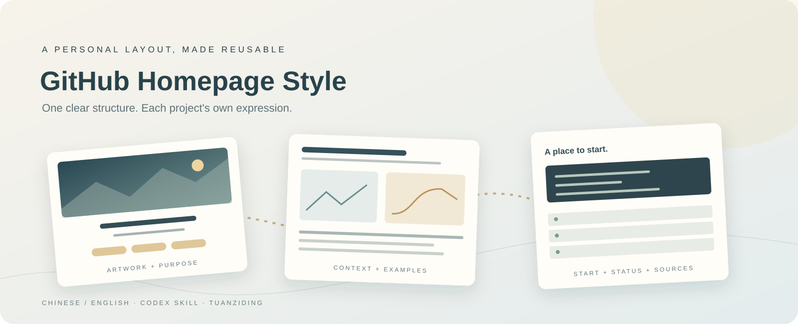
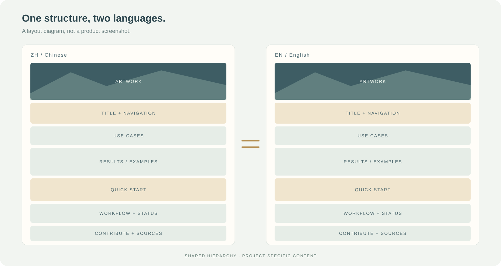

<p align="center">
  
</p>

<h1 align="center">GitHub首页布局 · GitHub Homepage Style</h1>

<p align="center">
  <strong>把熟悉的布局，变成可以复用的技能。</strong><br>
  Turn a familiar layout into a reusable skill.
</p>

<p align="center">
  为Codex准备的双语仓库首页技能，让每个项目都有清楚的介绍与使用入口。<br>
  A Codex skill for consistent bilingual repository homepages.
</p>

<p align="center">
  <a href="README.md">简体中文</a> · <a href="文档/英文说明v1.0.md">English</a>
</p>

<p align="center">
  <a href="https://github.com/TUANZIDING/github-homepage-style/releases/latest"></a>
  <a href="https://github.com/TUANZIDING/github-homepage-style/actions"></a>
  <a href="LICENSE"></a>
</p>

<p align="center">
  <code>宽幅主图</code> · <code>中英文模板</code> · <code>清楚的使用入口</code> · <code>按项目调整</code>
</p>

<p align="center">
  <a href="#use-cases">为什么用它</a> ｜ <a href="#showcase">布局一览</a> ｜ <a href="#quick-start">安装使用</a> ｜ <a href="#capabilities">能力状态</a> ｜ <a href="#contribute">参与共创</a>
</p>

<p align="center"><sub>主图为原创SVG版式示意；不是Codex或GitHub的产品截图。</sub></p>

---

<a id="use-cases"></a>

## 少重复调格式，多讲清楚项目 · Use cases

这是从个人项目中整理出来的首页结构。让Codex先沿用已经选好的布局，再根据项目的内容、素材和实际功能调整。

| 你遇到的问题 | 这个技能怎样帮助 |
| --- | --- |
| 每次上传仓库都要重新解释排版 | 保存固定的信息顺序、主图位置、导航和页脚。 |
| 中文写得完整，英文只有一句介绍 | 提供独立中英文首页模板，保持结构与事实一致。 |
| 图片漂亮，但使用入口埋得很深 | 将使用场景、成果和快速开始放在技术配置之前。 |
| 同一结构要用于不同类型的项目 | 允许删减模块，按主题换图片和配色。 |

<a id="showcase"></a>

## 一套秩序，两种语言 · Layout at a glance

<p align="center">
  
</p>

**主图 → 双语标题与定位 → 语言、状态与导航 → 使用场景 → 成果展示 → 快速开始 → 工作流 → 能力状态 → 配置 → 共创与来源**

| 中文模板 | English template |
| --- | --- |
| [查看可复制的中文结构](skills/github-homepage-style/assets/中文首页模板v1.0.md) | [Open the English structure](skills/github-homepage-style/assets/英文首页模板v1.0.md) |
| [布局规范](skills/github-homepage-style/references/布局规范v1.0.md) | [念景基准案例](skills/github-homepage-style/references/念景首页基准v0.2.1.md) |

念景是版式来源。基准案例的素材链接指向固定公开版本，本项目没有打包其视频、音乐或主图。上方双语示意图展示结构，不是某次自动生成的README结果。

<a id="quick-start"></a>

## 安装，然后说出你的需求 · Quick start

在Codex中发送：

```text
安装这个GitHub仓库里的技能：
https://github.com/TUANZIDING/github-homepage-style/tree/main/skills/github-homepage-style
```

安装后，在下一轮对话中使用：

```text
使用 $github-homepage-style 整理这个仓库首页。
保留真实功能与使用命令，提供中文和完整英文首页。
```

也可下载[技能包](https://github.com/TUANZIDING/github-homepage-style/releases/latest)，将其中的`github-homepage-style`目录放到`${CODEX_HOME:-$HOME/.codex}/skills/`。已有同名技能时先比较版本，保留自己的修改。

[详细安装与使用](文档/使用指南v1.0.md) · [English guide](文档/英文说明v1.0.md#quick-start)

<a id="workflow"></a>

## 先读内容，再整理布局 · Workflow

**读取仓库 → 选择有效模块 → 替换模板内容 → 对齐双语 → 检查链接与事实 → 按任务授权发布**

| 你决定什么 | Codex怎样处理 |
| --- | --- |
| 项目的定位与用途 | 先读取原有README和文档，保留实际内容。 |
| 是否沿用默认结构 | 采用宽幅主图、居中标题、导航、双列展示和简洁表格。 |
| 项目有哪些素材与能力 | 缺少对应内容的模块省略；概念图、截图和成果分开标记。 |
| 是否需要公开发布 | 安装或调用技能本身不自动执行GitHub发布。 |

<a id="capabilities"></a>

## 当前包含什么 · Capability status

| 状态 | 内容 | 边界 |
| --- | --- | --- |
| 已提供 | 技能入口、布局规范、中英文模板、基准案例、来源记录 | 模板中的变量需要按目标仓库替换。 |
| 包结构检查 | 文件摘要、技能引用、双语导航、文档链接与公开包路径 | 检查成功不代表目标项目的功能已经验证。 |
| 由Codex执行 | 根据当前仓库阅读、改写和整理首页 | 不是独立网站生成器，不承诺每次输出完全相同。 |
| 按任务选择 | 生成主图、截图、提交代码与发布 | 需要相应工具、素材和当前任务授权。 |

<details>
<summary><strong>想把它设为自己的默认布局？ / Set it as your default</strong></summary>

安装技能后，可在自己的Codex全局`AGENTS.md`里加入：

```text
整理GitHub仓库首页时，默认使用 github-homepage-style 技能。
沿用它的结构，图片、配色和模块按项目调整。
当前任务的明确要求优先。
```

这一步由使用者选择；技能包没有包含作者的个人全局配置，也不会改写其他人的设置。

</details>

<a id="contribute"></a>

## 一起把首页做得更清楚 · Contribute

欢迎补充适合研究、课程、开发工具和数据项目的真实案例；改进双语表达、路径处理与窄屏阅读。保留结构的可选性，不把某个项目的配色或结果强加给所有仓库。

| 你想了解什么 | 从这里进入 |
| --- | --- |
| 技能如何工作 | [SKILL.md](skills/github-homepage-style/SKILL.md) |
| 安装与调用 | [使用指南](文档/使用指南v1.0.md) |
| 排版细则 | [布局规范](skills/github-homepage-style/references/布局规范v1.0.md) |
| 来源与素材 | [素材说明](文档/素材说明v1.0.md) |
| 首版变化 | [v1.0.0发布说明](文档/发布说明v1.0.md) |
| 问题或建议 | [GitHub Issues](https://github.com/TUANZIDING/github-homepage-style/issues) |

本地检查无需第三方Python依赖：

```sh
python3 验证/项目检查v1.0.py
```

---

<p align="center">
  <strong>GitHub首页布局 · GitHub Homepage Style</strong><br>
  一套熟悉的结构，留给每个项目自己的表达。<br>
  <a href="https://github.com/TUANZIDING">TUANZIDING</a> · <a href="LICENSE">MIT</a> · <a href="文档/素材说明v1.0.md">素材来源</a>
</p>

<sub>独立社区技能项目，与Codex或GitHub官方模板没有隶属关系。许可适用于本仓库的原创文档、模板和SVG；外链项目的素材遵循其各自说明。</sub>
